## Project Title 
Nature’s Eye
## Project description 
Nature's Eye is a comprehensive web platform dedicated to nature enthusiasts, wildlife photographers, and travel adventurers. The website acts as a hub to discover hidden landscapes, connect with professional photographers, browse media galleries, and join specialized club expeditions.
The application is structured into distinct, feature-specific sections:

###  Authentication
 **Login & Sign Up:** Handles secure user authentication, allowing users to create new accounts or log into existing profiles.

###  Core Content Pages
 **Home:** Highlights the "Photographer of the Month" (based on top user engagement), showcases the platform's most interacted-with photographs, and displays curated global imagery using modern, card-based UI layouts.
 **About Us:** Details the platform’s mission, user expectations, and the overarching vision for Nature's Eye.
 **Contact Us:** Features an integrated communication portal allowing users to reach out directly via email.
 **Destination:** A dedicated space to browse and filter various travel and geographic locations.
 **Gallery:** A comprehensive visual archive displaying all uploaded images paired with their exact location names.
 **ClubTrips is an interactive, open-source directory designed to help adventure enthusiasts discover and join hiking and ecological expeditions organized by non-profit clubs and communities worldwide.** The platform highlights eco-friendly and cultural trips dedicated to nature preservation and exploring unique landscapes—ranging from alpine glaciers and ancient forests to high-altitude turquoise lakes.

The **Saved Photos** page serves as a personal collection where users can view the specific places they like or plan to visit. It provides a clean, visual gallery dedicated entirely to displaying the landscapes and destinations that the user has saved.


###  Future Roadmap (Upcoming Pages)
 
 **Photographer:** A directory highlighting the diverse network of photographers publishing their work on the platform.
 
 ##  Setup Instructions

Follow these steps to run the project locally on your machine.

### Prerequisites
Make sure you have a modern web browser installed.

### Installation & Local Run
1. **Clone the repository:**
   ```bash
   git clone https://github.com
   ```
2. **Navigate into the project directory:**
   ```bash
   cd p1
   ```
3. **Open the project:**
   * Double-click the `index.html` file to open it directly in your browser.
   * *Alternatively*, if using VS Code, right-click `index.html` and select **Open with Live Server**.
 ###  Desktop Layout
#### Header component
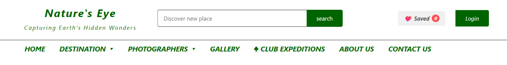
#### Home Page Part 1
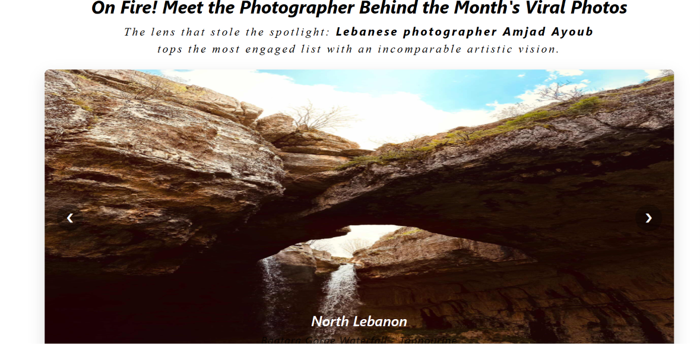
#### Home Page Part 2
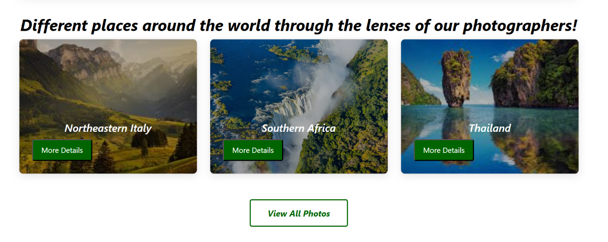
#### About Us Page part 1
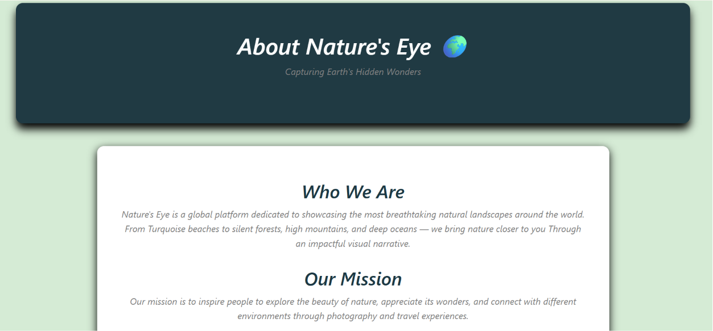
#### About Us Page part 2
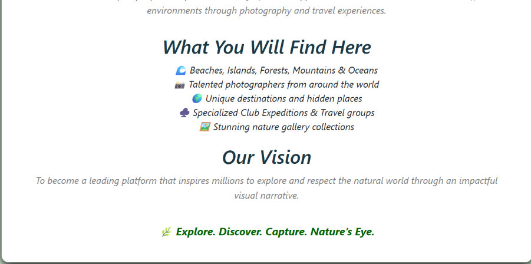
#### Contact Us Page 
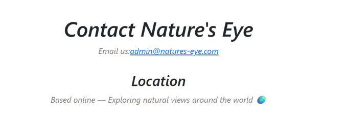

#### Login Page

#### Sign up Page
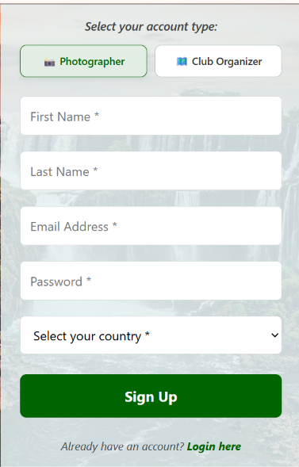

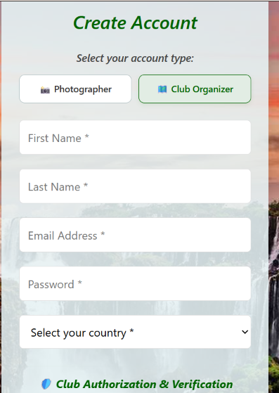
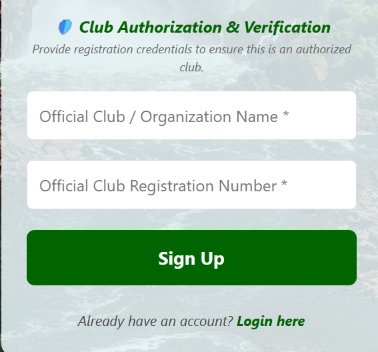
#### Gallery Page
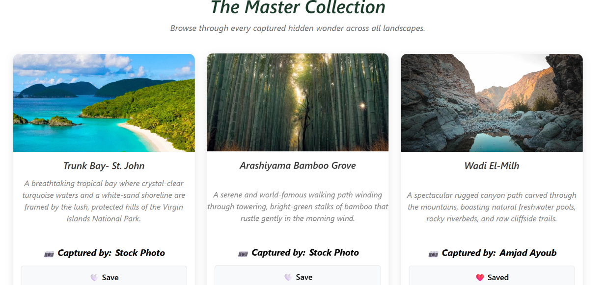

#### Saved Photos Page
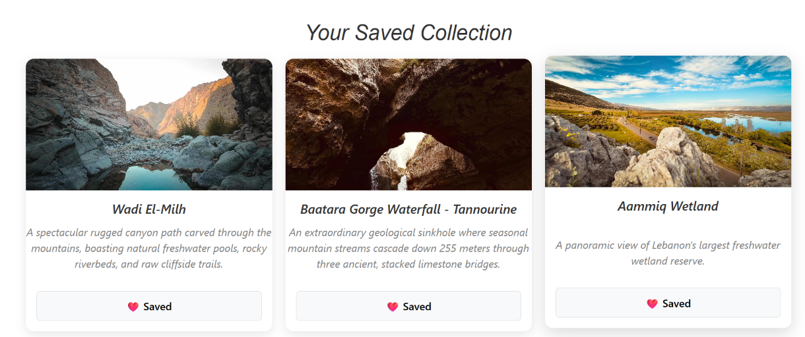

#### Destination Page
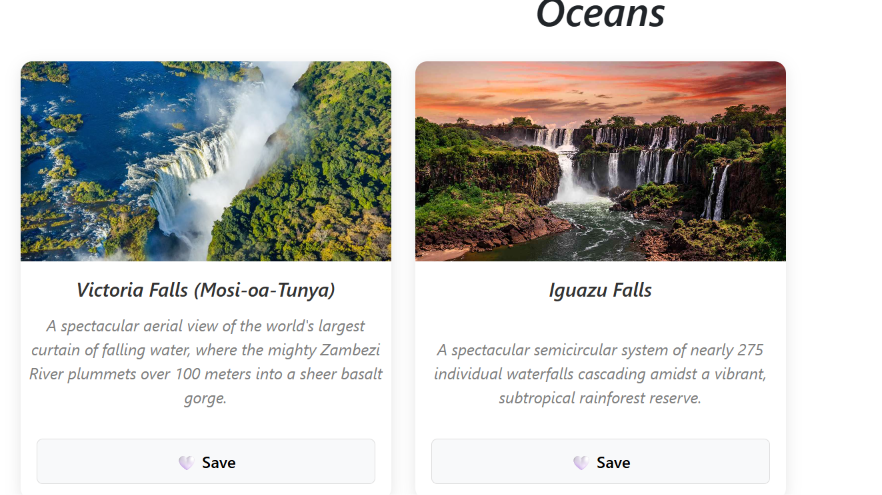
>  **Architectural Note:** Every environmental section listed below (including Mountains and Forests) utilizes the exact same scalable data-generation rate, component schemas, and layout architectures demonstrated in the **Ocean** module to ensure consistent UI performance across all categories.

#### Club Expeditions Page
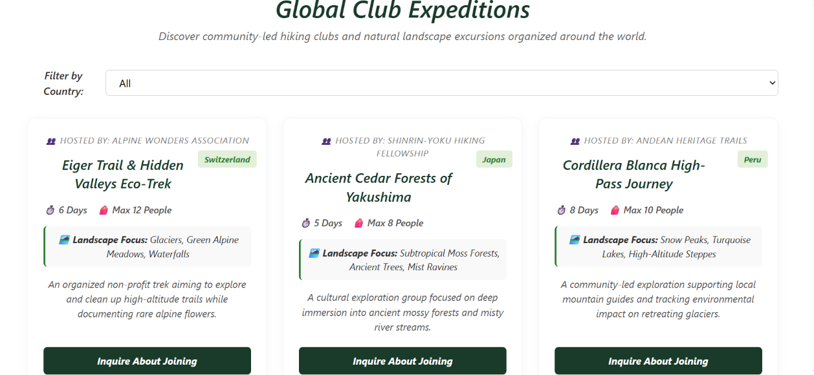
#### Footer 


